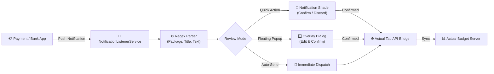
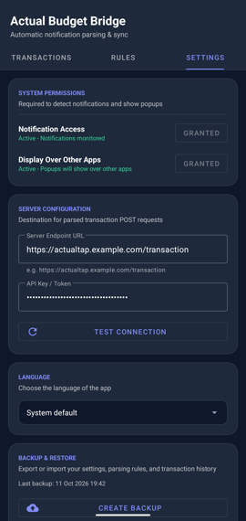
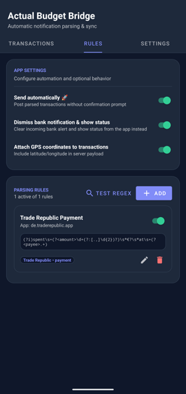

<p align="center">
  
</p>

<h1 align="center">Actual Budget Bridge</h1>

<p align="center">
  <strong>An automated Android companion app for syncing transaction notifications directly into your personal Actual Budget.</strong>
</p>

<p align="center">
  <a href="https://github.com/aydarik/actual-bridge/releases"></a>
  <a href="https://github.com/aydarik/actual-bridge/blob/master/LICENSE"></a>
  <a href="https://developer.android.com/about/versions/13"></a>
  <a href="https://kotlinlang.org"></a>
</p>

---

## 📖 Overview

**Actual Budget Bridge** captures financial transaction notifications from your mobile banking and payment apps in real-time. Using configurable regular expressions, it extracts transaction details - such as payee, amount, account, date, and payment type - and syncs them directly to your self-hosted [Actual Budget](https://actualbudget.org/) instance via [Actual Tap](https://github.com/MattFaz/actualtap).

### Why Actual Budget Bridge?

- **Zero Manual Entry**: Never forget to log an in-person purchase or morning coffee again.
- **100% Private & Self-Hosted**: Runs entirely on your Android device. Your financial data communicates directly with your own server - no third-party clouds, analytics, or trackers.
- **You Stay in Control**: Choose between effortless 1-tap notification reviews, floating popup dialogs, or zero-touch auto-send.

---

## ✨ Features

- **⚡ Real-Time Capture**: Intercepts status bar notifications from payment apps and digital wallets (Google Wallet, bank apps, fintech cards) the moment they arrive.
- **🎯 Flexible Regex Parsing Engine**:
  - Filter notifications by target app package name (e.g. `com.google.android.apps.walletnfcrel` or `*` for all).
  - Optional title regex filtering.
  - Named capture groups for `amount`, `payee`, `account`, `type` (payment vs. deposit), and `date`.
  - Robust currency parsing supporting international formats (handles `$1,234.56`, `1.234,56 €`, `£15.00`, etc.).
- **🧪 Built-in Rule Tester & Playground**: Test and validate your regex patterns against sample notification texts inside the app before saving or deploying them.
- **👆 Multiple Review & Confirmation Modes**:
  - **Notification Quick Actions**: Review payee and amount directly in your Android notification shade with 1-tap actions (`Confirm & Send`, `Review / Edit`, `Discard`).
  - **Floating Review Dialog**: Launch an instant overlay prompt over any running app when a transaction is detected.
  - **Zero-Touch Auto-Send**: Automatically sync parsed transactions in the background without prompting.
  - **Auto-Dismiss Original**: Option to automatically clear the original bank notification once captured.
- **📍 Location Tagging**: Optionally record GPS coordinates (latitude & longitude) at the moment of payment to remember purchase locations.
- **📊 Transaction History & Monthly Summary**:
  - View all captured transactions categorized by month with total spend calculation.
  - Status indicators: `SENT`, `FAILED`, `DISCARDED`, or `PARSED`.
  - One-tap retry for failed transmissions.
- **💾 Full Backup & Restore**: Export and import your server settings, parsing rules, and transaction history as a JSON file via Android Storage Access Framework (SAF), with smart merge or replace options.
- **🌐 Multilingual**: Available in English, German (Deutsch), and Russian (Русский).
- **🔄 In-App Update Checker**: Check for newer releases and download APK updates directly from GitHub.

---

## 🏗️ Architecture & Workflow



---

## 📋 Prerequisites

Actual Budget Bridge requires both of the following installed and running on your server:

1. **[Actual Budget](https://actualbudget.org/)** — your personal finance manager.
2. **[Actual Tap](https://github.com/MattFaz/actualtap)** — a lightweight server-side API bridge that accepts POST requests and writes transactions to your Actual Budget accounts.

---

## 🚀 Getting Started

### 1. Download & Install

Download the latest `actual-budget-bridge-*.apk` from the **[Releases](https://github.com/aydarik/actual-bridge/releases)** page and install it on your Android device (Android 13 / API 33 or newer).

### 2. Configure Server Connection

Open the app and go to the **Settings** tab:
1. Enter your **Server Endpoint URL** (e.g. `https://actualtap.yourdomain.com/transaction`).
2. Enter your **API Key / Token** configured in Actual Tap.
3. Tap **Test Connection** to verify that your mobile device can reach your Actual Tap endpoint.



### 3. Grant Permissions

In the **Settings** tab, ensure the required permissions are granted:

| Permission | Purpose | Required? |
| :--- | :--- | :---: |
| **Notification Access** | Allows the app's background listener service to read banking alerts. | **Yes** |
| **Post Notifications** | Allows the app to show 1-tap confirmation prompts and sync alerts. | **Yes** |
| **Display Over Other Apps** | Enables the floating review dialog over other apps when a transaction occurs. | Optional |
| **Location Access** | Attaches GPS coordinates to transactions. | Optional |

> [!IMPORTANT]
> If you enable **Attach Location**, ensure you select **"Allow all the time"** in system settings so the app can obtain coordinates in the background when processing notifications.

### 4. Configure & Test Parsing Rules

Go to the **Rules** tab to manage how incoming notifications are parsed:



The app includes default preset rules for standard card payments and income deposits. You can edit them or add new rules for your specific bank or wallet app:

- **Target App Package**: Package name of your bank app (e.g., `com.google.android.apps.walletnfcrel`) or `*` for all apps.
- **Title Regex (Optional)**: Filter notifications by title (e.g., `Chase Card Alert` or `Google Pay`).
- **Text Regex**: A regex pattern with named capture groups to extract transaction fields:
  - `(?<amount>...)`: Captured transaction amount.
  - `(?<payee>...)`: Captured merchant or payee name.
- **Account & Default Type**: Assign a default account name (e.g., `Checking`) and transaction type (`Payment` or `Deposit`).

#### 🧪 Testing Rules in the App

Use the **Test Notification Parser** section on the Rules tab:
1. Paste a sample notification title and text (or tap **Sample Payment** / **Sample Deposit**).
2. Tap **Test Parsing** to see the extracted payee, amount, account, and matched rule.
3. Tap **Simulate Popup Dialog** to preview how the review dialog will appear on your device.

---

## 🛠️ Development & Building from Source

### Prerequisites
- **JDK 24** or newer
- **Android SDK** with platform `android-36` (Build Tools 36.0.0)

### Clone & Build
```bash
git clone https://github.com/aydarik/actual-bridge.git
cd actual-bridge

# Run unit tests
./gradlew test

# Build debug APK
./gradlew assembleDebug

# Build unsigned release APK
./gradlew assembleRelease
```

The compiled APK will be located in `app/build/outputs/apk/`.

---

## ❓ Troubleshooting

<details>
<summary><strong>Notifications are not being detected or parsed</strong></summary>

1. Verify that **Notification Access** is enabled for *Actual Budget Bridge* in Android Settings (`Settings > Apps > Special app access > Notification access`).
2. Aggressive OEM battery management (e.g., Samsung One UI, Xiaomi HyperOS/MIUI) may kill background services. Add *Actual Budget Bridge* to the battery optimization exclusion list ("Unrestricted").
3. Use the **Test Notification Parser** on the Rules tab to ensure your regex matches the exact text of your bank's notification.
</details>

<details>
<summary><strong>Server connection test fails</strong></summary>

1. Ensure the URL is accessible from your mobile device (e.g., test it in Chrome on the phone).
2. If using local IP / internal domain, make sure you are connected to the same Wi-Fi or have your VPN active (e.g. Tailscale / WireGuard).
3. Check that your API key matches the token expected by your Actual Tap instance.
</details>

<details>
<summary><strong>Location coordinates are missing</strong></summary>

Make sure **Attach Location** is toggled ON in Settings and the permission is set to **"Allow all the time"** rather than "While using the app", since transaction processing happens while the app is in the background.
</details>

---

## 🤝 Contributing

Contributions, bug reports, and feature requests are welcome!

- Found a bug or have a suggestion? Open an [Issue](https://github.com/aydarik/actual-bridge/issues).
- Want to contribute a default rule preset for your bank? Submit a [Pull Request](https://github.com/aydarik/actual-bridge/pulls).

---

## 📄 License

This project is licensed under the [MIT License](LICENSE).
